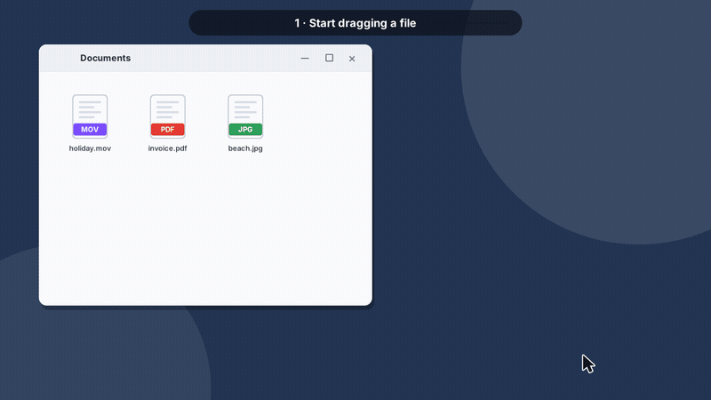
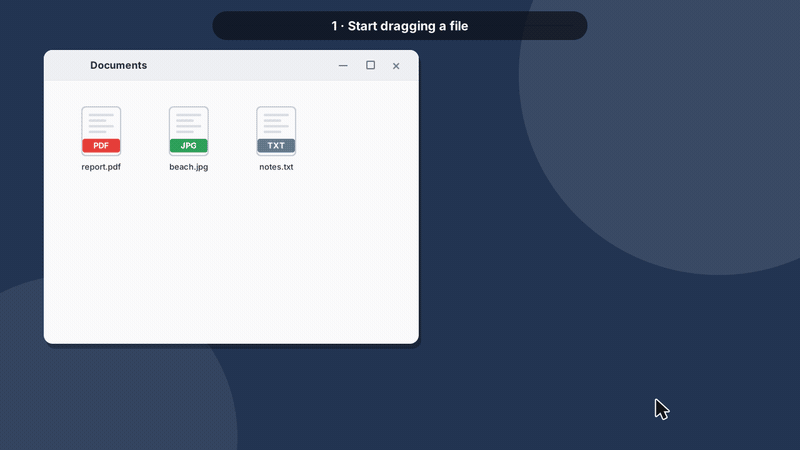
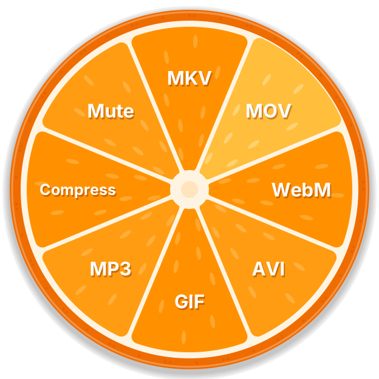
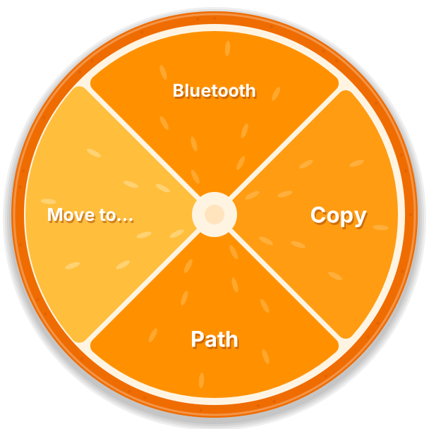
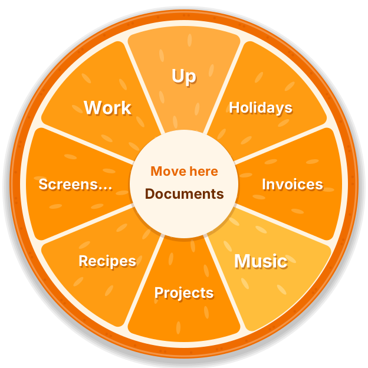
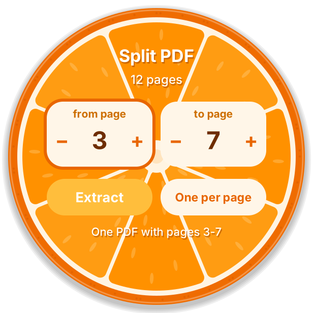
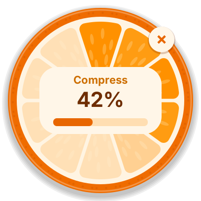

<p align="center">
  
</p>

<h1 align="center">Mandarino</h1>

<p align="center">
  <b>Offline file converter and file actions for Windows and Linux.</b><br>
  Drag files, press <kbd>Shift</kbd> to convert or <kbd>Ctrl</kbd> for actions, drop on a slice of the wheel.
</p>

<p align="center">
  <a href="../../releases/latest"><b>Download</b></a> ·
  <a href="#how-to-use">How to use</a> ·
  <a href="#features">Features</a> ·
  <a href="#install">Install</a> ·
  <a href="#build-from-source">Build</a> ·
  <a href="#faq">FAQ</a>
</p>

<p align="center">
  
</p>
<p align="center"><i>Drag → <kbd>Shift</kbd> → drop on a format. The converted file appears next to the original.</i></p>

<p align="center">
  
</p>
<p align="center"><i>Drag → <kbd>Ctrl</kbd> → Bluetooth, Copy, Path or Move to… (browse your folders inside the wheel).</i></p>

<p align="center">
  
  
  
  
  
</p>

<sub>The animations are illustrations rendered by the real drawing code (<code>make demo</code>); MP4 versions are in <code>docs/demo/</code>.</sub>

## Why

Converting a video, shrinking a photo, pulling three pages out of a PDF or
sending a file to your phone should not mean uploading it to a random website
or opening three programs. Mandarino does it **in the middle of a drag**,
right where your files are, **without internet**.

- **100% offline**: no uploads, no account, no telemetry, no ads.
- **One gesture**: drag, tap a key, drop on a slice.
- **Safe**: conversions never touch the originals; new files never overwrite anything (`photo (1).png`).
- **Free and open source** (MIT). Nothing to install: ffmpeg and pdfium are bundled.

## How to use

### Windows

In **File Explorer** (or on the desktop) start dragging one or more files and, while still holding the mouse button:

| Key | Wheel | Slices |
|-----|-----------|--------|
| <kbd>Shift</kbd> | **Convert** | the formats that make sense for the files |
| <kbd>Ctrl</kbd> | **Actions** | **Bluetooth** · **Copy** · **Path** · **Move to…** |

Move onto a slice (it lights up, and the label under the dragged files says what will happen) and **release**.
Press the other key to switch wheel. Releasing anywhere else is a normal drag & drop; <kbd>Esc</kbd> cancels.
Near the edges of the screen the wheel moves inwards so it is never cut.

**Move to…** — rest on it and the wheel turns into your folders (Desktop, Documents, Downloads, drives…).
Rest on a folder to open it, *Up* goes back, *More…* shows more. Drop on a folder, or on **Move here** in the middle.
The move uses the standard Windows file operation (progress, "replace or skip", undo with <kbd>Ctrl</kbd>+<kbd>Z</kbd>).

**Bluetooth** opens the Windows Bluetooth transfer with the files (it asks which device), or the Bluetooth settings if Bluetooth is off or missing.
**Copy** puts the files on the clipboard (paste with <kbd>Ctrl</kbd>+<kbd>V</kbd> in any folder, mail or chat); **Path** copies their full path.

### Linux

Select files in your file manager and right-click:

| Entry | Shortcut (GNOME Files) | Wheel |
|-------|------------------------|-----------|
| **Mandarino** (*Scripts* in GNOME Files, *Convert with Mandarino* elsewhere) | <kbd>Ctrl</kbd>+<kbd>Shift</kbd>+<kbd>M</kbd> | Convert |
| **Mandarino Actions** | <kbd>Ctrl</kbd>+<kbd>Alt</kbd>+<kbd>M</kbd> | Bluetooth · Copy · Path · Move to… |

The same wheels open under the mouse; click a slice. *Open With → Mandarino* works in every file manager.
(There is no drag gesture on Linux: Wayland does not let programs watch the keyboard globally.)

## Features

| Files | Convert (<kbd>Shift</kbd>) |
|-------|----------------------------|
| **Images** — JPG, PNG, WebP, BMP, TIFF, GIF, ICO, HEIC, AVIF | to JPG, PNG, WebP, BMP, TIFF, GIF, ICO, PDF · several images into **one PDF** · **50%** size · **Compress** · phone photos keep their orientation |
| **Video** — MP4, MOV, MKV, WebM, AVI, WMV, FLV, MPG, 3GP, TS, MTS | to MP4, MKV, MOV, WebM, AVI · **animated GIF** · **extract MP3** · **Compress** (H.264, up to 1080p) · **Mute** |
| **Audio** — MP3, WAV, FLAC, M4A, AAC, OGG, Opus, WMA, AIFF, AMR | to MP3, WAV, FLAC, M4A, OGG, Opus |
| **PDF** | pages to PNG or JPG · **Merge** · **Split**: choose *from page* / *to page*, then one PDF or one file per page |

**Actions** (<kbd>Ctrl</kbd>) work on any file and on folders: send with **Bluetooth**, **Copy** to the clipboard, copy the **Path**, **Move to…** a folder chosen inside the wheel.

More:

- **Progress wheel** for long jobs: slices ripen as the work advances. Drag it anywhere, <kbd>×</kbd> cancels, right click hides it.
- **Screen recordings that play everywhere**: constant frame rate, even dimensions, one stereo track.
- **No half-written files**: a video is called `… - in progress.mp4` until it is complete.
- High-DPI and multi-monitor aware; Windows 11 Explorer tabs; X11 and Wayland (XWayland) on Linux.

## Install

### Windows 10 / 11 (64-bit)

1. Download `Mandarino-x.y.z-windows-x64.zip` from the [latest release](../../releases/latest).
2. Right-click the zip → **Extract All…** (for example into `Documents\Mandarino`).
3. Run `Mandarino.exe`. If SmartScreen says *"Windows protected your PC"*, click **More info → Run anyway** (the program is not code-signed).

An orange icon appears next to the clock; Mandarino starts with Windows from now on (you can turn this off from the icon's menu).
Uninstall: icon menu → untick *Start with Windows* → *Quit*, then delete the folder.

### Linux (x86-64)

```sh
tar xzf mandarino-x.y.z-linux-x64.tar.gz
cd mandarino
./install.sh
```

The installer copies Mandarino to `~/.local/share/mandarino` (no root needed) and adds the menu entries to
GNOME Files (Nautilus), Nemo, Caja, Dolphin and Thunar, plus *Open With* everywhere. Restart the file manager once (`nautilus -q`).
Needs glibc 2.34+ (Ubuntu 22.04, Debian 12, Fedora 35 or newer). Notifications use `notify-send`;
Bluetooth uses `bluetooth-sendto` (GNOME) or `blueman-sendto`.
On Wayland the wheel opens in the middle of the screen (Wayland does not tell programs where the mouse is).

Uninstall: `mandarino --uninstall`, then delete `~/.local/share/mandarino` and `~/.local/bin/mandarino`.

## How it works

```
 Windows: drag in Explorer ─► hooks ─Shift/Ctrl─► wheel (OLE drop target) ─drop─┐
 Linux:   right click ─► mandarino [--actions] FILES ─► wheel (X11 + cairo) ─click─┤
                                                                                    ▼
          engine ─► ffmpeg (audio, video, some images) · pdfium (PDF) · Go stdlib (JPG/PNG/GIF/BMP/ICO, PDF writer)
          actions ─► clipboard · move · Bluetooth
```

- **`engine/`**: every conversion, no UI (`go test ./engine` runs anywhere).
- **`ui_*.go`**: the wheels (convert, actions, page picker, folder browser, progress) drawn through a small `Canvas` interface,
  implemented with **GDI+** on Windows and **cairo** on Linux, so both platforms share the same look and logic.
- **Windows**: low-level hooks notice "drag from Explorer + Shift/Ctrl"; the wheel is a round layered window and an
  **OLE drop target** written as a tiny COM object in Go — Windows itself tells it which files are dragged and where the
  pointer is, and the drop is answered with "nothing happened" so Explorer never moves the files by itself.
  Pure Go + `syscall`: no cgo, no external modules, a ~3 MB executable.
- **Linux**: the file manager starts Mandarino with the selection; the wheel is an X11 window drawn with cairo.

See [CONTRIBUTING.md](CONTRIBUTING.md) for a map of the source code.

## Build from source

Requirements: [Go 1.22+](https://go.dev/dl/). For the Linux build also cgo and `sudo apt install libx11-dev libxext-dev libcairo2-dev`.

```sh
git clone https://github.com/peppezip/mandarino-file-converter.git
cd mandarino-file-converter

GOOS=windows GOARCH=amd64 go build -ldflags "-H=windowsgui" -o Mandarino.exe .   # Windows (from any OS)
go build -o mandarino .                                                          # Linux

scripts/fetch-deps.sh && scripts/build.sh 1.0.0    # release archives with ffmpeg and pdfium, in dist/
```

Tests: `sudo apt install ffmpeg && scripts/fetch-deps.sh linux && MANDARINO_TOOLS=$PWD/third_party/linux go test ./...`

## FAQ

**Is it really offline?** Yes. There is no networking code at all. Unplug the cable and try.

**Are my files moved when I drop them on the wheel?** Only if you choose *Move to…*. For everything else Mandarino tells Explorer the drop did nothing.

**Why does my antivirus complain (Windows)?** Recognizing "drag + Shift/Ctrl" needs low-level mouse and keyboard hooks, which some antivirus heuristics dislike. Mandarino only looks at the left button, the pointer, Shift and Ctrl (plus Esc and a few keys while a wheel is open) and never stores or sends anything. See [SECURITY.md](SECURITY.md).

**Why a right-click menu on Linux instead of the drag gesture?** Wayland (rightly) forbids watching the keyboard globally, and every Linux file manager handles drags differently. The menu entries and the GNOME shortcuts work everywhere.

**macOS?** Not planned for now.

## Contributing

Issues and pull requests are welcome: new formats, actions, translations, file-manager integrations. Read [CONTRIBUTING.md](CONTRIBUTING.md) first.

## License

Mandarino is released under the [MIT License](LICENSE).
Release archives bundle [FFmpeg](https://ffmpeg.org) (GPL) and [PDFium](https://pdfium.googlesource.com/pdfium/) (BSD/Apache): see [THIRD_PARTY_NOTICES.md](THIRD_PARTY_NOTICES.md).
